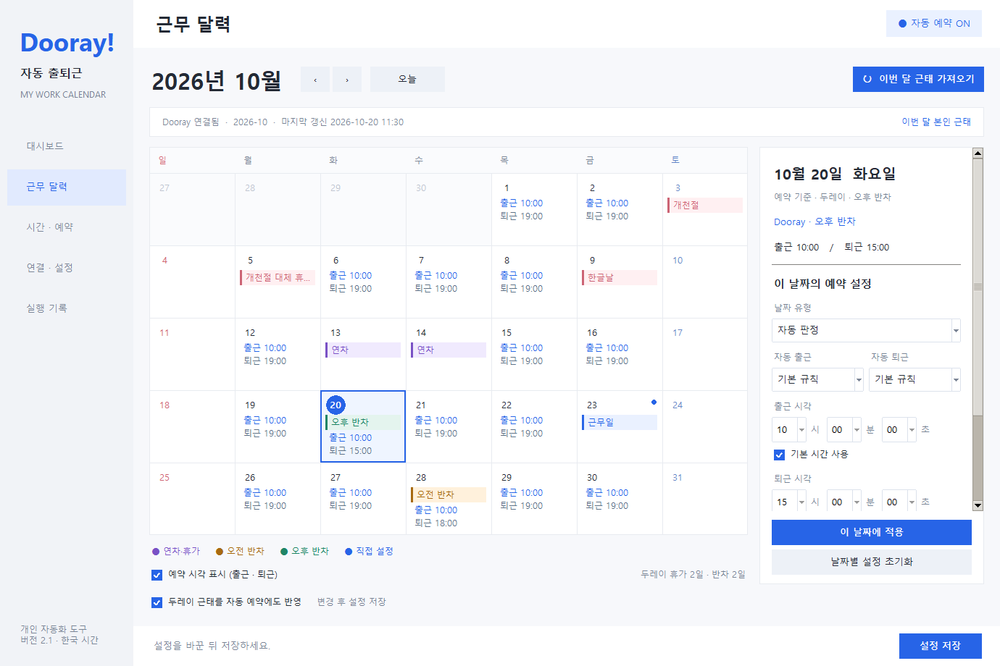
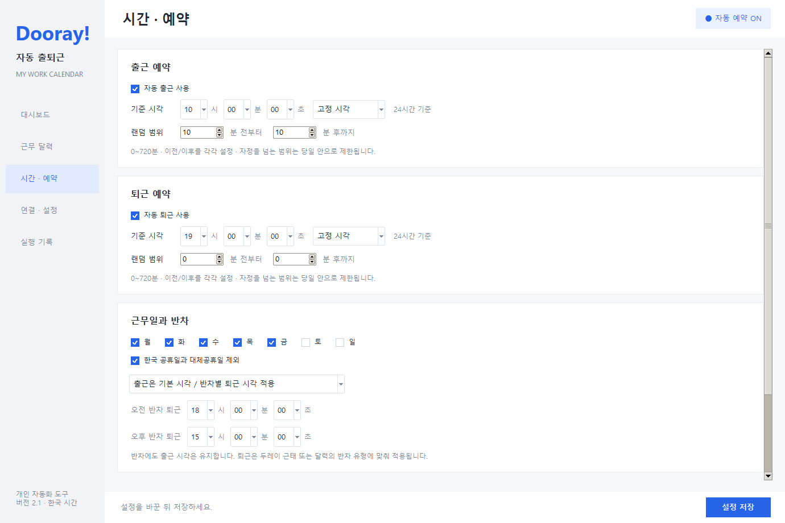
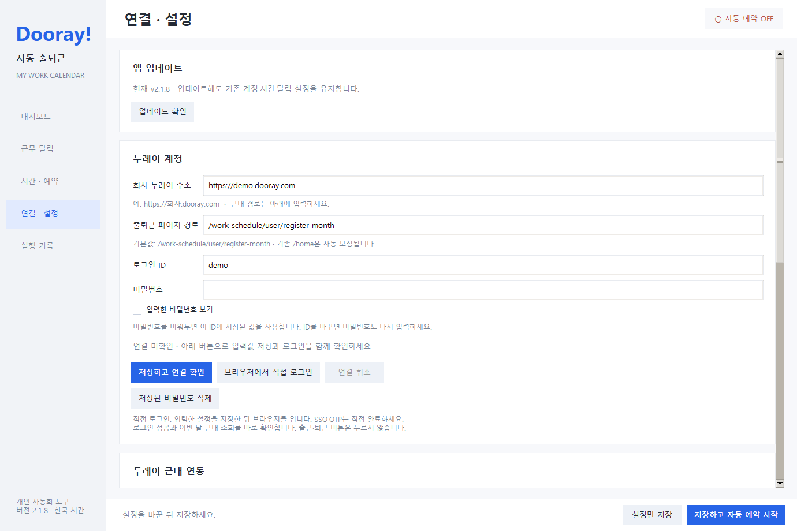
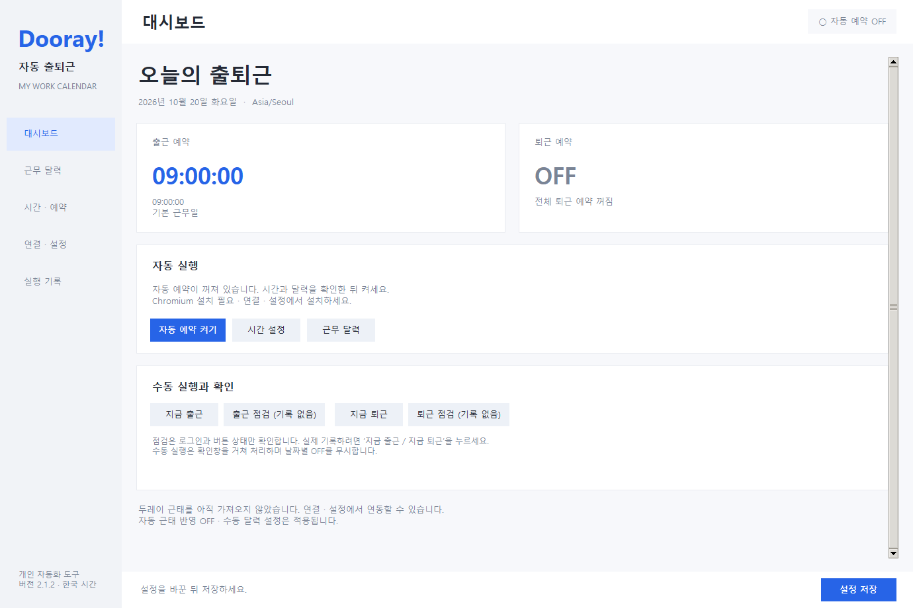

# 두레이 자동 출퇴근

Windows에서 Dooray 출퇴근 예약, 근무 달력, 개인 근태를 관리하는 데스크톱 프로그램입니다. 현재 버전은 **2.1.9**입니다.

[프로그램 소개 페이지](https://kimasill.github.io/dooray-auto-checkin/) · [화면과 함께 설치하기](https://kimasill.github.io/dooray-auto-checkin/guide.html) · [프로젝트 소개 글](https://kimasill.github.io/dooray-auto-checkin/story.html)

[Windows 설치 파일 다운로드](https://github.com/kimasill/dooray-auto-checkin/releases/download/v2.1.9/DoorayAutoCheckin-v2.1.9-windows.zip) · [설치 방법](#설치와-업데이트) · [연결 문제 해결](#연결이-안-될-때)

## 화면 미리보기

아래는 실제 프로그램 화면입니다. 일정과 설정값은 기능을 보여 주기 위한 예시입니다.

### 근무 달력

연차·오전 반차·오후 반차와 출퇴근 예정 시각을 한눈에 확인합니다. 날짜를 클릭하면 오른쪽에서 해당 날짜의 근태와 예약을 설정할 수 있습니다.



### 시간 · 예약

시·분·초 드롭다운으로 시간을 선택하고, 랜덤 범위를 분·초로 정하고 오전·오후 반차별 퇴근 시각을 지정합니다.



## 설치와 업데이트

**2.1.3부터 앱 안에서 업데이트할 수 있습니다.** 연결 · 설정 → **업데이트 확인** → **다운로드 및 설치**를 누르세요. 공식 GitHub 배포본의 SHA-256과 파일 구성을 검사한 뒤 설치하고 앱을 다시 엽니다. 기존 계정·비밀번호·시간·달력·예약 ON/OFF는 유지하며, 실패 시 기존 버전과 예약을 복원합니다. 이전 버전은 아래 ZIP으로 한 번 업데이트해주세요.

**시간 설정만 저장하면 자동 예약은 시작되지 않습니다.** 하단의 **저장하고 자동 예약 시작**을 누르고 상단에 **자동 예약 실행 중**이 표시되는지 확인하세요. Windows 작업 등록과 실제 감시 프로세스 실행을 모두 확인합니다. 고정 시각에서는 랜덤 입력을 잠그며, 랜덤 범위를 선택하면 적용되는 시간 범위를 보여줍니다. 예: 09:55, 앞뒤 5분 → **09:50:00~10:00:00**에서 1초 단위로 하루 한 시각을 선택하며 대시보드에 오늘의 선택 시각을 초까지 표시합니다. 2.1.6부터 범위도 **5분 30초 전 ~ 2분 15초 후**처럼 설정할 수 있습니다. 이 경우 09:55 기준 범위는 **09:49:30~09:57:15**입니다. 선택 시각에 처리를 시작하므로 접속·로그인·네트워크에 따라 실제 두레이 기록은 늦어질 수 있습니다.

1. [최신 릴리스](https://github.com/kimasill/dooray-auto-checkin/releases/latest)에서 `DoorayAutoCheckin-v2.1.9-windows.zip`을 받습니다.
2. 압축을 풀고 `설치.bat`을 실행합니다.
3. 프로그램의 **연결 · 설정**에서 회사 두레이 주소, 로그인 ID와 비밀번호를 입력하고 **저장하고 연결 확인**을 누릅니다.
4. **시간 · 예약**에서 출근·퇴근 시각을 설정하고, 대시보드에서 **자동 예약 켜기**를 누릅니다.

업데이트는 기존 계정·시간·달력 설정과 예약 ON/OFF 상태를 유지합니다. 이전 실행 파일·설정·예약은 `%LOCALAPPDATA%\DoorayCheckin\backups`에 백업합니다. 비밀번호는 Windows 자격 증명 관리자에 저장되며 배포 패키지에는 개인 계정 설정이 포함되지 않습니다. 설치 시 필요한 Chromium을 내려받으므로 인터넷 연결이 필요합니다.

## 연결이 안 될 때

**ID·비밀번호를 입력한 뒤 반드시 `저장하고 연결 확인`을 누르세요.** 현재 입력값을 저장하고 로그인 → 출퇴근 화면 → 이번 달 근태 순서로 확인합니다. 출근·퇴근 기록은 변경하지 않습니다. 결과와 해결 방법은 계정 입력란 아래에 남습니다.



- **회사 주소:** `https://회사.dooray.com`까지만 입력합니다. 출퇴근 페이지 경로와 본인 월별 근태 경로의 기본값은 모두 `/work-schedule/user/register-month`입니다. `/home`은 홈 화면이므로 출퇴근 버튼이 표시되지 않을 수 있습니다.
- **비밀번호:** 비워두면 현재 ID에 저장된 비밀번호를 사용합니다. ID나 비밀번호를 바꿨다면 새 비밀번호를 입력하고 다시 연결 확인을 누르세요. 입력한 비밀번호 보기로 오타를 확인할 수 있습니다.
- **SSO·OTP·추가 인증:** **브라우저에서 직접 로그인**을 누릅니다. 열린 브라우저에서 직접 인증을 완료하면 세션을 저장합니다. 최대 3분 기다리며 앱에서 취소할 수 있습니다. 일반 Chrome의 로그인 상태는 이 앱과 별개입니다.
- **로그인 성공 / 근태 조회 실패:** 계정 인증은 통과했지만 달력을 가져오지 못한 상태입니다. 본인 월별 근태 경로와 회사의 근태 조회 권한을 확인하세요.

| 화면에 표시되는 코드 | 확인할 내용 |
|---|---|
| `PASSWORD_MISSING` / `CREDENTIAL_STORE` | 현재 Windows 계정에서 비밀번호를 다시 저장 |
| `CREDENTIALS` | ID·비밀번호 오타, 회사 웹에서 사용하는 로그인 ID |
| `ACCOUNT_LOCKED` / `PASSWORD_EXPIRED` | 웹에서 계정 잠금 해제·비밀번호 변경 또는 관리자 문의 |
| `EXTRA_AUTH` / `SSO` | 브라우저에서 직접 로그인으로 회사 인증 완료 |
| `ADDRESS` / `NETWORK` | 회사 주소, 인터넷·VPN·프록시 |
| `CERTIFICATE` | PC 날짜·시간, 회사 보안 인증서 |
| `LOGIN_FORM` | ID·비밀번호가 전송되기 전 입력 화면 확인 필요. 직접 로그인으로 진행 |
| `LOGIN_UNCONFIRMED` | 일시적인 성공 확인 실패. 자동 예약은 설정된 횟수·간격으로 재시도하며 영구 차단하지 않음 |
| `PAGE_UNCONFIRMED` / `ATTENDANCE_PAGE` / `HTTP` | 회사 주소·출퇴근 페이지 경로·접속 권한 |
| `BROWSER` | 연결 · 설정 아래의 Chromium 설치 |

**웹 로그인은 됐지만 앱이 계속 기다릴 때:** 2.1.9로 업데이트한 뒤 **저장하고 연결 확인**을 한 번 실행하세요. 기존 `/home`·`/home/` 설정은 실제 근태 경로 `/work-schedule/user/register-month`로 자동 보정됩니다. 다른 사용자 지정 경로와 계정·시간·예약 설정은 유지합니다. 로그인 뒤 메일·프로젝트로 이동한 경우에도 근태 페이지로 이동해 확인합니다. `브라우저에서 직접 로그인`은 열린 창에 사용자가 ID·비밀번호를 직접 입력하는 기능입니다.

2.1.9부터 로그인 시간 제한이 끝났더라도 실제 로그인 완료 상태를 마지막으로 다시 확인합니다. 이전 버전이 저장한 `LOGIN_UNCONFIRMED` 영구 차단은 다음 자동 접속 시 해제하며, 재시도는 설정된 횟수·간격과 기존 예약 유효 범위 안에서 진행합니다. 이미 놓친 과거 출퇴근 기록을 소급 생성하지 않습니다.

비밀번호 오류·잠금·추가 인증 등이 확인되면 반복 로그인을 중지합니다. 설정을 수정한 후 **저장하고 연결 확인** 또는 **브라우저에서 직접 로그인**으로 다시 확인하세요. 2.1.1부터 계정별 세션을 분리하므로 업데이트 후 처음 연결할 때 다시 로그인할 수 있습니다. 저장된 계정·비밀번호·시간 설정은 유지됩니다.

## 주요 기능

- **근무 달력:** 월간 보기, 공휴일·대체휴일, 날짜별 출퇴근 ON/OFF 및 시간 설정
- **본인 근태 표시:** 이번 달 연차·휴가, 오전 반차, 오후 반차를 색상별로 표시
- **쉬운 시간 선택:** 출근·퇴근·반차·날짜별 시간을 시·분·초 드롭다운으로 선택
- **출퇴근 예약:** 고정 시각 또는 기준 시각 이전/이후 각각 0~720분 + 0~59초의 랜덤 범위, 범위 안에서 1초 단위로 선택
- **반차별 퇴근:** 출근 시각은 유지하고 오전·오후 반차의 퇴근 시각을 별도 지정
- **설정 보존:** 이전 버전 설정 호환, 중복 처리 방지, 날짜별 수동 설정 우선 적용

## 퇴근 기록과 예약 확인

**퇴근 점검 (기록 없음)**은 로그인·버튼·현재 기록을 확인하는 기능입니다. 새 퇴근 기록을 만들려면 **지금 퇴근**을 누르고 확인창에서 실제 처리를 선택하세요. 기존 ‘퇴근 테스트’와 혼동하지 않도록 이름과 완료 안내를 변경했습니다.



- 자동 퇴근은 **퇴근 예약 사용**, **자동 예약 ON**, 오늘 날짜의 예약·시간을 확인하세요. 최근 실행 실패 원인은 대시보드의 퇴근 예약 카드에 표시됩니다.
- 다른 작업과 겹치면 즉시 실패하지 않고 진행 중인 작업 이름과 대기 상태를 표시합니다. 점검·연결은 최대 2분, 예약 실행은 최대 4분 기다립니다.
- 실패 알림이나 재시도 대기 중에는 브라우저를 잠그지 않습니다. 같은 날 같은 실패 알림은 반복해서 띄우지 않습니다.
- 허용 시간 안에 접수한 예약은 조회·잠금 대기 시간을 반영해 처리합니다. 이미 허용 시간이 지난 예약을 소급 실행하지 않습니다.
- 두레이의 90일 비밀번호 변경 안내에 **다음에 변경하기**가 제공되면 해당 선택으로 로그인을 계속합니다. 실제로 변경이 필수인 화면은 중단하고 안내합니다.

2.1.1에서 선택 가능한 비밀번호 안내를 필수 변경으로 오인해 저장한 차단은 2.1.2에서 다시 확인합니다. 로그인 문제를 해결하더라도 이미 지나간 출퇴근 기록을 임의로 생성하지 않습니다.

## 다른 PC에서 예약이 실행되지 않았을 때

실패한 **그 PC에서, 앱을 사용한 Windows 계정으로** [진단 도구 ZIP](https://github.com/kimasill/dooray-auto-checkin/releases/download/v2.1.9/Dooray-diagnostics-tool.zip)을 내려받아 압축을 풀고 **진단로그수집.bat**을 실행하세요. 바탕화면에 생성되는 `Dooray-diagnostics-날짜-시간-식별자.zip`을 분석 담당자에게 전달하면 됩니다. 실패한 날짜와 기대한 예약 시각도 함께 알려주세요.

예약 설정, 최근 실행 로그, 결과 상태, 앱 버전, Windows 작업 상태와 절전·부팅 이벤트를 모읍니다. 비밀번호 저장소·로그인 세션·스크린샷·원본 설정 파일은 수집하지 않으며 계정 ID·회사 URL과 날짜별 메모를 제외합니다. 출퇴근 처리, 설정 변경, 자동 전송은 하지 않습니다. 일부 Windows 이벤트를 읽을 수 없어도 나머지 로그는 수집됩니다.

도구 없이 로그만 전달하려면 `Win + R`에서 `%LOCALAPPDATA%\DoorayCheckin\logs`를 열고 `checkin.log`를 보내주세요. 원본 로그에는 계정·주소가 남아 있을 수 있으므로 진단 도구 사용을 권장합니다.

## 근태를 예약에 반영하기

저장된 계정으로 앱을 열면 이번 달 본인 근태를 가져옵니다. 가져온 연차·반차는 자동 예약 반영 여부와 관계없이 캘린더에 표시합니다. 날짜를 선택하면 오른쪽에서 근태와 예약 시각을 확인할 수 있습니다.

휴가일 자동 실행 제외와 반차별 퇴근 시각 적용을 사용하려면 달력 아래 **두레이 근태를 자동 예약에도 반영**을 체크한 후 **설정 저장**을 누르세요. 날짜별 수동 설정이 우선하며 전체 출근·퇴근 사용 OFF 상태에서는 실행되지 않습니다.

현재 월의 근태를 조회합니다. 다른 달은 날짜별로 직접 설정할 수 있습니다. 자동 예약이 실행되려면 PC가 켜져 있고 Windows에 로그인되어 있어야 합니다. 앱 창을 닫아도 켜 둔 Windows 예약은 유지됩니다.

## 개발 환경

Python 3.14 / Windows에서 빌드와 검증을 수행했습니다.

```powershell
python -m venv .venv
.\.venv\Scripts\python.exe -m pip install -r Duray\requirements.txt pyinstaller
.\.venv\Scripts\python.exe -m playwright install chromium
.\.venv\Scripts\python.exe Duray\dooray_gui.py
```

첫 실행 시 로컬 `Duray/config.json`이 기본값으로 생성됩니다. `Duray/config.example.json`은 계정 정보가 비어 있는 설정 예시입니다. 로컬 설정과 실행 기록은 Git에서 제외됩니다.

```powershell
# 개인정보가 없는 배포 패키지 빌드
.\Duray\make_package.ps1 -Python .\.venv\Scripts\python.exe -Out .\release

# 규칙 및 UI 테스트
.\.venv\Scripts\python.exe -m unittest discover -s Duray\tests -p test_attendance.py -v
.\.venv\Scripts\python.exe -m unittest discover -s Duray\tests -p test_gui.py -v
```

브라우저 테스트는 `DOORAY_TEST_BROWSER`에 설치된 Chromium의 `chrome.exe` 경로를 지정한 후 전체 테스트를 실행합니다. 외부 요청은 모의 HTML로 대체합니다. 로그인 화면 지연, 단계별 로그인, 잘못된 비밀번호, 추가 인증, SSO, 취소, 실제 출퇴근을 하지 않는 연결 확인을 검증합니다.

자세한 설정과 예약 동작은 [사용·개발 문서](Duray/README.md), 버전별 변경은 [변경 기록](CHANGELOG.md)을 참고하세요.

Dooray 화면 구성을 참고한 개인 자동화 도구입니다.
